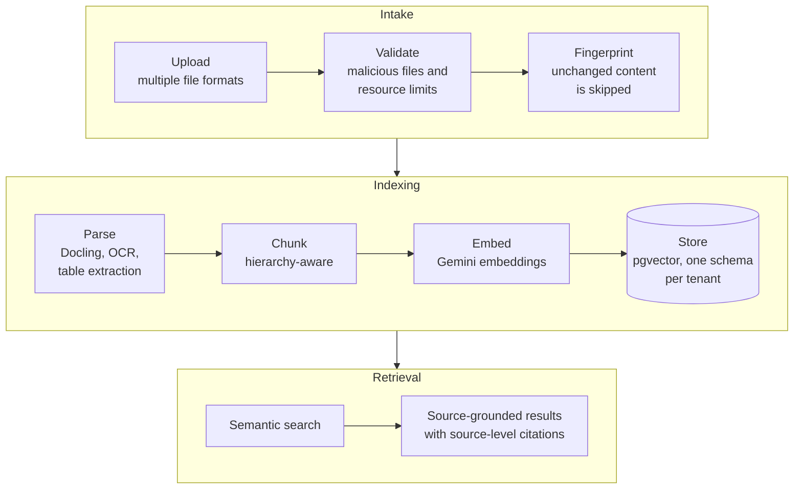

  

  <picture>
    <source media="(prefers-color-scheme: dark)" srcset="https://readme-typing-svg.demolab.com?font=Fira+Code&weight=500&size=20&pause=1200&color=60A5FA&center=true&vCenter=true&width=760&lines=Multi-tenant+SaaS+backends+in+Django+and+FastAPI;RAG+ingestion+pipelines+on+PostgreSQL+and+pgvector;Backend+for+AI+agent+platforms+and+MCP+servers;APIs+that+serve+100K%2B+requests+per+day" />
    
  </picture>

  
  
  
  

I'm a Senior Software Engineer with nearly 5 years of experience building backend systems and AI/LLM platforms in Python, Django, and FastAPI for teams in the U.S. and Pakistan. I own services end to end, from data model and API design through deployment on AWS and Google Cloud Run.

## What I'm working on

- **Multi-tenant document ingestion and vector indexing** at Techset Solutions: company documents go in, searchable vector indexes on PostgreSQL and pgvector come out.
- **The backend for AI agent platforms:** agent configuration, tool agents, MCP servers, evaluators, retrieval, memory, and model switching.
- **What I care about most:** data modeling, query performance, and concurrency. That means finding N+1 queries, fixing inefficient ORM usage, and keeping configuration handling safe under concurrent access.

## Impact in production

<table>
  <tr>
    <td align="center" width="25%"><h2>100K+</h2><b>requests per day</b> Django and FastAPI services on AWS</td>
    <td align="center" width="25%"><h2>35%</h2><b>lower API latency</b> Redis caching and asynchronous request handling</td>
    <td align="center" width="25%"><h2>40%</h2><b>higher throughput</b> work moved to Celery and RabbitMQ</td>
    <td align="center" width="25%"><h2>30%</h2><b>faster PostgreSQL responses</b> query optimization</td>
  </tr>
</table>

## Featured work

### Multi-Tenant Document Intelligence Platform · 2026

A multi-tenant SaaS platform that processes company documents into searchable vector indexes for semantic search and source-grounded information retrieval.

- Built the end-to-end ingestion pipeline: multiple file formats, OCR, table extraction, chunking, embeddings, and vector storage.
- Implemented hierarchy-aware chunking and source-level citations for retrieval accuracy, and content fingerprinting so unchanged documents are not processed twice.
- Enforced tenant isolation through PostgreSQL schemas and transactional document updates.
- Secured file uploads against malicious files and resource-exhaustion attacks, and shipped versioned REST APIs with permissions and OpenAPI documentation.

`Python 3.12` `Django 5` `DRF` `PostgreSQL` `pgvector` `Docling` `Gemini Embeddings` `Docker` `Google Cloud Run`

### Generative AI Workspace Platform

A multi-tenant generative AI SaaS platform on Google Cloud Run where teams configure AI models, manage workspaces, and use AI-powered tools across multiple LLM providers.

- Stabilized the platform by resolving about 20 tracked issues across four repositories in three months.
- Improved workspace-level AI model resolution and BYOK configuration across six LLM providers, fixing model inheritance for a tool shared with 31 workspaces.
- Reduced AI response delays with incremental streaming for workflows that took 80 to 100 seconds, eliminated 32 redirect round trips, and optimized sequential data loading.
- Resolved cross-service SSO session expiry across the frontend, the Django API, and the OAuth2 identity service.
- Improved data integrity and caching with diff-only updates, server-side ownership validation, and Redis-based token introspection caching.
- Addressed penetration-test findings with environment-driven CORS restrictions and frontend dependency upgrades, validated with pytest and Playwright on staging.

`Python` `DRF` `React` `Next.js` `Redis` `OAuth2` `Google Cloud Run` `pytest` `Playwright`

### More projects

| Project | What it does | Stack |
| :--- | :--- | :--- |
| **LLM-Powered Recruitment Chatbot & Resume Intelligence System** | LLM features inside an enterprise ERP recruitment workflow: resume analysis, structured candidate data extraction, and a chatbot that answers candidates' questions from their application records. | Python, Django, LLM integration, REST APIs |
| **AI-Powered Chartered Accountancy & Financial Assistance Platform** | A Django and React platform that uses company-specific information for AI-assisted accounting, tax tasks, financial analysis, and context-aware question answering. | Python, Django, React.js |

> Most of this is client and company work, so the code is private. I'm happy to talk through the architecture.

## Tech stack

  

| Area | Technologies |
| :--- | :--- |
| **Languages** | Python, JavaScript (ES6+), SQL |
| **Backend** | Django, Django REST Framework, FastAPI, Flask, REST API design, OpenAPI |
| **AI & LLM** | RAG ingestion pipelines, embeddings, pgvector, AI agents, MCP servers, LangChain, OpenAI API, Gemini API, Docling |
| **Databases** | PostgreSQL, MySQL, MongoDB, query optimization, indexing, multi-tenancy (django-tenants) |
| **Async & Messaging** | Celery, Redis, RabbitMQ |
| **Cloud & DevOps** | AWS (EC2, S3, RDS, Lambda), Google Cloud Run, Docker, Kubernetes, CI/CD |
| **Testing & Auth** | pytest, Playwright, OAuth2 |
| **Automation** | Scrapy, Selenium |
| **Frontend** | React.js, Next.js, MUI, Bootstrap |

## Experience

| Role | Company | Period | Focus |
| :--- | :--- | :--- | :--- |
| **Senior Software Engineer** | Techset Solutions Lahore, Pakistan | Jun 2026 – Present | AI/LLM platform backends, multi-tenant document ingestion, vector indexing |
| **Software Engineer** | AAK Tele-Science, Inc. United States (Remote) | Apr 2025 – Jun 2026 | Django and FastAPI services on AWS, Redis caching, LangChain and OpenAI API integrations |
| **Associate Software Engineer** | TylexTech Lahore, Pakistan | Jul 2023 – Apr 2025 | Scrapy and Selenium data pipelines, Celery and Redis task processing (25% more efficient), React.js dashboards |
| **Associate Software Engineer** | Conzummate Private Limited and other clients Lahore and Multan, Pakistan | Jan 2022 – Jul 2023 | Django REST Framework APIs, PostgreSQL and MySQL query optimization, Celery and RabbitMQ workflows |

**Education:** BS Software Engineering, Virtual University of Pakistan (2016 – 2020)

## Currently exploring

Distributed systems · Database internals · Concurrency · System design · Agentic systems

## Let's connect

I'm always glad to talk about backend engineering, Python and Django, AI infrastructure, and system design. I also write on LinkedIn about backend engineering, scalability, and finding your way around unfamiliar codebases.

- **Email:** [qasim_kamran2007@yahoo.com](mailto:qasim_kamran2007@yahoo.com)
- **LinkedIn:** [linkedin.com/in/mohammad-qasim-kamran](https://www.linkedin.com/in/mohammad-qasim-kamran)
- **Stack Overflow:** [mohammad-qasim-kamran](https://stackoverflow.com/users/28639829/mohammad-qasim-kamran)
