<!-- Every image on this page is a self-hosted SVG in assets/, generated by tools/build_assets.py. Tech icons: skill-icons by tandpfun (MIT). -->

  

  
  
  
  
  

I'm a Senior Software Engineer with nearly 5 years of experience building backend systems and AI/LLM platforms in Python, Django, and FastAPI for teams in the U.S. and Pakistan. I own services end to end, from data model and API design through deployment on AWS and Google Cloud Run.

## Current focus

  
  
  

## Impact in production

  
  
  
  

## Technical skills

  

  
  
  
  
  
  

## Experience and education

  
  
  
  
  
  

## Contact

  

Most of my work is client and company code, so it is private. I'm glad to walk through the architecture. I also write on LinkedIn about backend engineering, scalability, and working in unfamiliar codebases.

  
  
  

